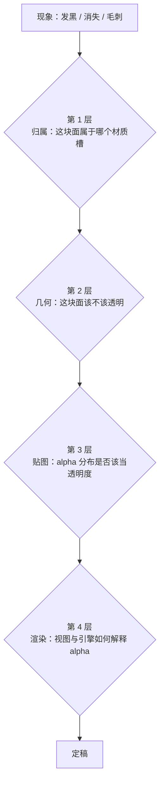

# 半透明材质处理流程（领袖模型专用，2026-11 守岸人双源对照验证）

半透明区域出问题时，现象几乎都是「发黑」「整片消失」「边缘毛刺」三种。这三种现象各有独立成因，混在一个参数上反复调永远调不出来。本文把半透明拆成四个互不干扰的判定层，每层有独立的取证方法与判据，按顺序执行。

## 一、判定层与顺序



顺序不可换。第 2 层的结论决定第 3 层要不要做，第 3 层的结论决定第 4 层绑不绑 Opacity。跳过第 1 层直接调参是最常见的浪费。

## 二、第 1 层：归属

判据：**在改任何贴图或 alpha 之前，先确定可见表面属于哪个材质槽。**

取证方法，三选一，按成本从低到高：

| 方法 | 命令/脚本 | 输出 |
|------|-----------|------|
| UV 采样 | `scan_dark_faces.py` 类脚本 | 逐材质统计「采样到深色像素的面数 / 该槽面数 / UV 区间 / 空间范围」 |
| 射线分层 | 沿视线方向逐层 ray_cast | 命中的材质名与纵深 y |
| 伪彩渲染 | 每槽一个纯色发光材质 | 一张按材质着色的图，肉眼即可读归属 |

守岸人实测（解包版 `A_shouanren_final.blend`，H=155.7）：

| 槽 | 面数 | 采样到深色像素（亮度<0.12）的面 | 占比 | 贴图 |
|---|---|---|---|---|
| `Down` | 33,902 | 2 | 0.0% | `Down_D.png` |
| `Eye` | 562 | 248 | 44.1% | `Eye_D.png` |
| `Up02` | 12,084 | 1,608 | 13.3% | `Upal2.png` |

修复前 `Down` 槽有 285 面落在深蓝区（UV u 0.155~0.225、v 0.64~0.93，采样得 RGB (43,79,159)、亮度 0.30），空间范围 X −1.5~1.9、Y −5.4~2.8、Z 119.0~130.3，正是胸口正中那条深色带。修复后降到 2 面。

**这条深色带与透明度无关。** 它是 `Down_D.png` 里本来就有的深色像素，被那片面的 UV 采到了。任何 alpha 调整都不会改变它。

对照官方 pmx 版：同一位置的归属完全不同。

| 层 | 解包版（H=155.7） | 官方 pmx（H=20.9） |
|---|---|---|
| 0 | y=−6.12 `Down` | y=−0.82 `声痕` |
| 1 | y=7.76 `Down` | y=1.05 `MI_Down` |
| 2 | y=13.06 `Hair` | y=1.75 `MI_Hair` |

官方版把星芒单独做成一层网格 `声痕`，材质用 `STAR shouanren.png`：alpha 均值 0.003、98.9% 像素 alpha<0.05，只有星芒那几个像素实心。第 0 层近乎全透明，所以后面那层肤色能透出来。

同一张 `Down_D.png` 在两个 UV 位置的采样值：官方版 (230,220,224) 亮度 0.87，解包版 (43,79,159) 亮度 0.30。

## 三、第 2 层：几何该不该透明

判据：**这块面在源资产的材质图里，有没有独立的透明承载层。**

按三种结构分别处理：

| 结构 | 特征 | 处置 |
|------|------|------|
| 独立透明网格 | 官方 pmx 的 `声痕`：单独一层网格，材质只有星芒 | 直接绑定该网格的 alpha 贴图，不动相邻槽 |
| 单一槽承载多个区域 | 解包版 `Alpha` 槽 11,484 面，Z 47~140，肩 78~93、胸 109~125、腹 62~78 全在这一个槽 | 按 UV 区间或空间范围切分子槽，每个子槽独立决定透明度 |
| 整槽实心但视觉上该透 | 颈部、胸罩、边角 | 不绑 alpha，靠几何本身与相邻层遮挡 |

解包版 `Alpha` 槽是第二种结构的典型。11,484 面里薄纱、内衬、胸口装饰共用一张 `Alpha_D.png`，单材质无法让其中一部分透明、另一部分不透明。曾按纵深 y 中位数 −2.20 切成 `AlphaOuter`（k=0.85）与 `AlphaInner`（k=0.40）两层，这是单槽结构下能做到的最细粒度。

对照 修模绑骨 pmx 的 41 个材质：`Alpha` 只绑在 `侧面 白`、`胸前1`（走 `Down_D hexieyong.png`）与 `MI_Bangs+`（走 `Bangs_D2.png`）三处；颈部、胸罩用 `MI_Down`、`胸口`、`腿`、`衣服`，全部走 `Down_D.png` 且不绑 alpha。

三种贴图的 alpha 分布：

| 文件 | alpha 均值 | 最小值 | frac<0.05 | 用途 |
|---|---|---|---|---|
| `Down_D hexieyong.png` | 0.078 | 0.000 | 92.1% | 真镂空，绑 Opacity |
| `Bangs_D2.png` | 1.000 | 1.000 | 0% | 全实心，不绑 |
| `STAR shouanren.png` | 0.003 | 0.000 | 98.9% | 星芒，绑 |

## 四、第 3 层：贴图 alpha 分布

判据：**只有「真镂空」才绑 Opacity。** 落点是 alpha 的两端占比，不看肉眼感觉。

```
full = frac(alpha >= 0.99)      # 意图被看见的区域
hole = frac(alpha <  0.10)      # 意图被镂空的区域
full >= 0.01 且 hole >= 0.01  →  真镂空，绑 Opacity（裁剪阈值 0.3333）
其余                          →  实心，Opacity 留空串
```

真镂空的 alpha 必然同时具备「完全可见」与「完全不可见」两端。缺任一端就不是透明度：
只有 hole、没有 full 的贴图是明暗蒙版，绑上就是整片变淡。

工具：`scripts/probes/alpha_bind_verdict.py <png|dds> …`（退出码 3 = 至少一张判为绑定）。

秧秧实测（`T_R2T1YangyangMd10011Body_D.png`）：max=0.565、full=0.0000、hole=0.1417 → 实心。
它的 alpha 通道是皮肤明暗细节，单看「有多少像素低于裁剪阈值」会把它当成镂空，绑上整块皮肤就变半透明；两端占比判据把它判成实心。

同批八槽：

| 槽 | full | hole | 结论 |
|---|---|---|---|
| `Bangs` | 0.5285 | 0.3869 | 真镂空，绑 |
| `3XingStar` | 0.0765 | 0.9187 | 真镂空，绑 |
| `Body` | 0.0000 | 0.1417 | 实心，不绑 |
| `Up` | 0.0000 | 0.5598 | 实心，不绑 |
| `Down` | 0.0000 | 0.1669 | 实心，不绑 |
| `Eye` | 0.0000 | 0.0326 | 实心，不绑 |
| `Face`、`Hair` | 1.0000 | 0.0000 | 实心，不绑 |

**刘海贴图的 alpha 是另一类问题。** 它的 alpha 不是镂空而是软边，但近零像素会把边缘画成黑色：

| 文件 | alpha 均值 | 最小值 | frac<0.1 |
|---|---|---|---|
| 解包 `Bangs_D.png` | 0.867 | 0.000 | 6.3% |
| 官方 `Bangs_D 134 108.png` | 0.944 | 0.580 | 0.0% |

解包图那 6.3% 的近零像素落在深色区，混色后前额末梢成黑块。换官方图即消失。判据：**刘海槽的 alpha 最小值低于 0.5 就要怀疑贴图，先换源再谈参数。**

## 四·五、第 3 层补充：就地 alpha 打通（发片实心化，2026-11 长离验证）

**触发**：同一张图里既有必须被裁掉的镂空（发丝缝），又有必须实心显示的可见面（额前发片正面），而 `GREATER_THAN(0.3333)` 把后者一起裁掉。典型现象是额发整片偏浅、发丝缝漏背景光，几何在 Blender 里明明存在。

**先过前置闸门**：先按 `texture-rules-matrix.md` §零 判定源 alpha 是不是透明度语义（`alpha==255` 占比 <0.005 且唯一值 >50 是 mask，不是透明度，那种直接整图压平 255，不做本节的局部打通）。再按 §二 确认这块可见表面属于**发片槽**而不是发帽槽。归属没定就打通，会把别处的洞一起补死。

### 操作口径

**粒度是 texel，不是面。** 一整面里既有要留的 texel 也有要打的 texel，按「面被裁掉」去补只能补出碎片化空洞。

| 不变式 | 内容 | 违反后果 |
|---|---|---|
| ① RGB 逐字节等于源图 | 只动 alpha 通道，颜色一个字节不改 | 色块（色阶移位 +24/−24 实测严重色块，被用户退回） |
| ② 只打通「正面 + 侧向」面集的**完整 UV 岛** | 面集按法线与视线夹角取，岛按连通性取完整，不取包围盒并集 | 取并集足迹会把外侧鬓发一起打成实心，边缘冒出实心方块 |
| ③ 背向面保留源 alpha | 朝内的那一层仍走镂空 | 内衬与外层同时实心，发缝彻底不透光，边缘出现硬分界 |

长离实测：额前发片 8,454 面 = 正面与侧向 7,925（texel α 置 255）+ 背向 529（保留源 α）。

### 判据（缺一不进 cook）

1. 打通面集与背向面集的**面数与空间范围**先打表，两组不得重叠；
2. 输出图与源图逐像素比较，**RGB 差为 0**（证明 alpha 之外零改动）；
3. 掩膜中 α=255 的 texel 覆盖率与面集投影面积吻合，偏差 >2% 说明行序或投影错，回查 `texture-pass.md` §三 的行序不变式，并用 `scripts/probes/mask_roworder_audit.py --mask <png> --uv <hair_uv.tsv>` 复算（退出码 4 即已翻转）；
4. 固定机位渲染，额发平均亮度与 Blender 参考差 <1（长离 87.4 vs 87.2）；
5. cook 后 `error asset` 为 0，实机色差消失才算通过。

### 已否决的做法

| 做法 | 结果 |
|---|---|
| 整张发片 alpha 全置 255 | 发丝缝被补死，发片变成一块硬片 |
| 只处理「整面被裁掉」的面 | 局部 texel 仍半透明，画面碎片化空洞 |
| 实心区平铺到面集的包围盒并集 | 外侧鬓发被带上，出现实心色块 |
| 色阶移位 / 提亮补偿 | 色块，且颜色偏离源图 |
| 整槽改 BLENDED 或半透明过渡 | 与相邻槽出现明显分界，实机更差 |
| 靠补几何（补内衬 / 收顶点）解决 | 只在真的「无面」时才成立，先做射线取证再动手 |

> 卡片之间的**透明空隙**与本节不是一件事：空隙是两块面之间根本没有面（射线穿透），贴图打通无效，只能补几何。先用射线分层取证（§二 方法二）区分「贴图被裁」与「几何缺面」，再选路线。

## 五、第 4 层：渲染器如何解释 alpha

这一层在 Blender 里调，与最终引擎无关，但它是「发黑」最大的来源。

### 5.1 Blender 4.5 的唯一权威属性

```
material.surface_render_method   ∈ {DITHERED, BLENDED}
```

4.5 里 `blend_method` 永远读回 `HASHED`，**不能当判据**。

无光追的 EEVEE Next 下，`BLENDED` 会把半透明表面塌成深色，`DITHERED` 正常。这条是守岸人排查中最耗时的弯路。

### 5.2 双面渲染会暴露内表面

把模型的背面剔除关掉（`use_backface_culling = False`）时，引擎会把内部的反向面也画出来，反向面不受光，呈现为黑。

判定方法：对同一机位各渲一张 `use_backface_culling = True` 与 `False` 的图，若黑色区域在开启剔除后消失，那就是内表面而非贴图问题。

守岸人的决定性证据：逐材质隔离渲染（`ISO_*.png`）显示贴图本身全是浅色、无黑；A/B/C 三组背面测试（`BF_A_twoSided.png` vs `BF_B_culled.png`）确认黑色来自内表面。

### 5.3 Opacity 绑定即进透明路径

```
材质绑了 Opacity 参数 → 该材质进透明通道 → alpha 测试按贴图裁切
纯白遮罩也一样 → 实心部位被当镂空 → 整片消失
```

实心部位必须解绑或整项删除。判据：材质只剩 `BaseColor` 一项。

## 六、本会话已排除的做法

以下每一条都在守岸人上试过并被证伪，不要再试：

| 做法 | 结果 | 原因 |
|------|------|------|
| 把 `BLENDED` 调成半透明 | 整片塌黑 | EEVEE Next 无光追时 BLENDED 的固有问题 |
| 用 `GREATER_THAN(0.333)` 做 alpha 裁切 | 边缘出现硬锯齿、内部空洞 | 阈值裁切不适合软边薄纱 |
| alpha 乘 K 系数分档（k=0.85 / 0.40 / … 六档阶梯） | 各档都只是整体变淡或变深，无法让某一块单独恢复正常 | 问题不在全局透明度，在归属与渲染路径 |
| 关闭背面剔除后调 alpha | 黑色不消失 | 黑来自内表面，alpha 改不了它 |
| 把整片深色带当成透明度问题调参 | 无改善 | 那条带是贴图本身的深色像素，属第 1 层归属问题 |

发片实心化（局部打通 alpha）的否决清单见 §四·五，与本表不重复。

## 七、交付判据

半透明区域定稿需同时满足：

1. 逐材质隔离渲染中，没有任何一个材质出现不明暗块；
2. 关闭背面剔除后画面与开启时一致（内表面不被看见）；
3. `surface_render_method == DITHERED`；
4. 每个材质的 Opacity 绑定状态与第 4 节的 full/hole 判定一致；
5. `.mtl` 的 Opacity 参数与 Blender 侧一致，实心槽为空串；
6. cook 后 `Replacing asset` 与 `error asset` 均为 0。
